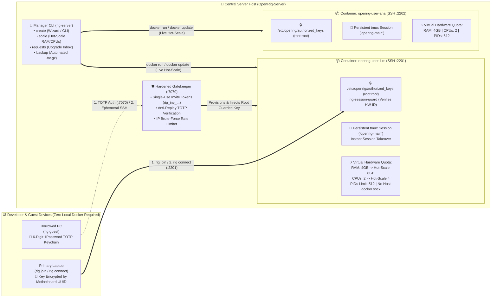

# 🏢 OpenRig-Server — Enterprise Multi-Tenant Workstation Orchestrator

[](./LICENSE)
[](./SECURITY.md)
[](#)

**OpenRig-Server** is the central multi-tenant orchestrator and hardware-bound enrollment gatekeeper for [**OpenRig**](https://github.com/LFR-SnowBall/OpenRig). It enables organizations and engineering teams to turn any Linux or macOS server into a **centralized cloud of isolated developer & security workstations** where developers connect from lightweight laptops with **zero local Docker required**.

---

## 🏛️ Multi-Tenant Architecture & Lifecycle



---

## ✨ Key Capabilities for Server Managers

1. **🎛️ Interactive or CLI Workstation Provisioning (`rig-server create`):**
   - Select the developer's requested skill profile (`python`, `jvm`, `frontend`, `mobile`, `sec`, `fullstack`), initial virtual RAM (`--ram`), and vCPUs (`--cpus`).
   - Automatically provisions an isolated container (`openrig-user-<name>`), dedicated bridge network (`openrig-net-<name>`), persistent workspace volume, and a **single-use 24h enrollment token (`rig_inv_...`)**.
2. **⚡ Live Hot-Scaling of Virtual Hardware Without Restart (`rig-server scale`):**
   - When a developer needs more RAM or vCPUs for a heavy compilation, they run `rig request 8g 4 "Reason"` inside their workstation.
   - The Server Manager inspects pending requests with `rig-server requests` and scales the running container **live in 1 second (`rig-server scale <user> --ram 8g --cpus 4`) with zero downtime and without closing their active `tmux` session**.
3. **🔐 Hardware-UUID Device Binding & Auto-Unlinking (`gatekeeper.py`):**
   - Each developer's SSH key is bound to their physical Motherboard/SoC UUID (`IOPlatformUUID` / `/etc/machine-id`) via `/etc/openrig/authorized_keys` (`root:root 0644`).
   - Re-enrolling on a new computer (`--replace`) automatically unlinks the previous computer so stolen keys cannot be used elsewhere.
4. **📲 Ephemeral Guest Mode via 6-Digit Keychain TOTP (`rig guest`):**
   - Allows developers to jump into their active `tmux` session (`Session Takeover`) from a borrowed PC using a 6-digit TOTP code from 1Password / Authenticator — burning both the TOTP code (Anti-Replay) and the temporary SSH key immediately upon login.

---

## 🚀 Quickstart for Server Managers

### 1. Clone & Start the Gatekeeper Service
```bash
git clone https://github.com/LFR-SnowBall/OpenRig-Server.git
cd OpenRig-Server

# Optional: Create global symlink for rig-server
mkdir -p ~/.local/bin && ln -sf "$(pwd)/rig-server" ~/.local/bin/rig-server

# Start the Hardened Gatekeeper enrollment service on port 7070:
nohup python3 ./gatekeeper.py >/var/log/openrig-gatekeeper.log 2>&1 &
```

### 2. Provision a Developer Workstation (`rig-server create`)
Run interactively (wizard mode) or pass flags directly:
```bash
# Interactive Manager Wizard (prompts for username, skills/role, initial RAM, and vCPUs):
./rig-server create

# Or direct CLI provisioning:
./rig-server create luis --role fullstack --ram 4g --cpus 2
```
This outputs a single-use enrollment command to share with the developer:
```text
👉 Share this command with 'luis' to bind their computer:
   rig join 192.168.1.100:7070 --token rig_inv_7f6a569be5e83a40c78e007f7d308860
```

### 3. Inspect Upgrade Requests & Hot-Scale Live (`rig-server requests` / `rig-server scale`)
```bash
# 1. Check pending virtual hardware requests submitted by developers (via 'rig request'):
./rig-server requests

# 2. Approve and hot-scale RAM & vCPUs live without restarting the container:
./rig-server scale luis --ram 8g --cpus 4

# 3. Monitor real-time CPU, RAM & container health across all tenants:
./rig-server status
```

### 4. Automated Workspace Backups (`rig-server backup`)
```bash
# Backup a specific developer's workspace or all tenants to ./backups/*.tar.gz:
./rig-server backup luis
./rig-server backup all
```

---

## 📋 Complete Command Reference (`rig-server`)

| Command | Description |
|---|---|
| `rig-server create [user] [--role R] [--ram M] [--cpus C]` | Interactive wizard or CLI to provision a user workstation with skills, virtual hardware & single-use invite token |
| `rig-server scale <user> --ram <M> --cpus <C>` | **Hot-scale** virtual RAM and vCPUs in real time (`docker update`) without restarting the user's session |
| `rig-server requests` | View pending virtual hardware upgrade requests submitted by users (`rig request`) |
| `rig-server invite create --user <u > [--replace]` | Generate a new single-use enrollment token (with `--replace` to unlink old hardware) |
| `rig-server invite list` / `revoke <token>` | List or revoke active invitation tokens |
| `rig-server status` | Display provisioned tenants, SSH ports, quotas, and live `docker stats` |
| `rig-server backup [user \| all]` | Create timestamped `.tar.gz` backups of user workspaces |
| `rig-server user [stop \| start \| remove] <user>` | Stop, start, or remove a tenant workstation |

---

## 📄 License

Released under the [**MIT License**](./LICENSE).  
Copyright © 2026 **Linux Open Source S.A. de C.V.** / **Luis Fernando Real (`LFR-SnowBall`)**.
